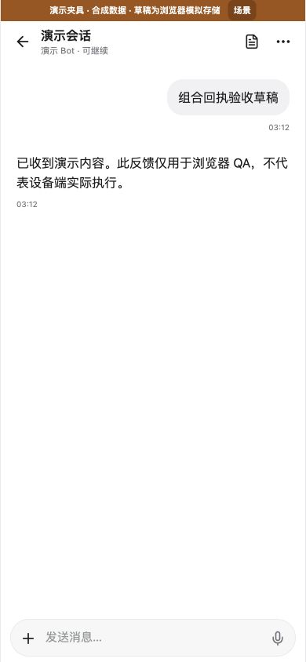
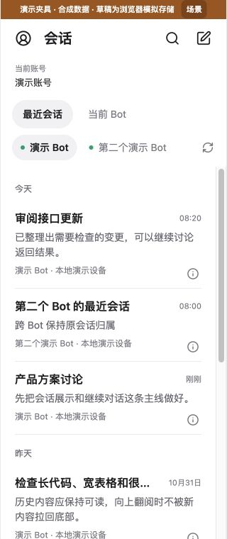
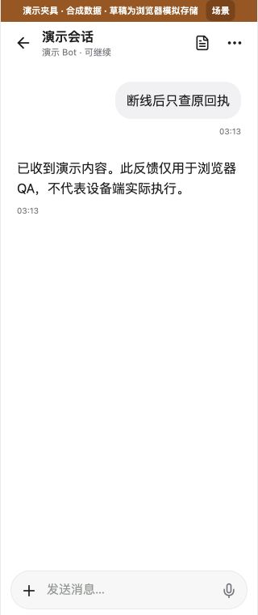

# iOS build 7 combination acceptance — 2026-11-01

Task MB-MOBILE-CONNECT-20261101. Mobile/cloud owner: 01a12b99-7b38-78b1-831f-9c60257d386a; shared CI/main/desktop owner: 01a12bc2-907a-7702-b6dd-788225c5dfe4. Human confirmed Kevin iPhone 16 Pro Max; latest instruction is package preparation only while it is unavailable. Daily Mac, original 101 identity/keys/configuration, cloud/database and business-message operations are excluded. Voice remains deferred.

## Selected source and conflict resolution

- Base main: e11ee39b5629d6e74810b75e2155a45400d45005.
- Identity/profile: bad2f934ed2a4f292ed22ad8bd50c09703cc4673.
- Installed native About/build 7: bf56c1a6e279f5c76fdb8c470b82d010f33d7302.
- Reliability: 03869a177df9721acc33cb81d53f25c1993d26d0.
- Both submitted sources are original Git ancestors, not copied WIP. Shared-plan conflict retains both records; home/index resolution retains both account prop/card and recent-session navigation/styles. No desktop/Host/cloud runtime source is changed.

## Independently found and repaired loss of a new draft

Before the integration fix, an actual native test of original text revision 1 -> changed text revision 2 -> same original text revision 3 -> late accepted receipt failed: revision 3 was erased. Fresh-target red evidence is retained in private `output/mobile-connect-20261101/exact-combined-before-fix-fresh.log`. The separate earlier cross-worktree Cargo-cache compile error is retained and is not treated as the product reproduction.

The reliability author's core-review statement that same-text re-edit is a wire-format limitation is superseded for this candidate by the following additive fix:

1. The existing native operation owner captures revision and lastWriteId in the same account/device operation scope before mutation dispatch. A strict, bounded separate record binds operation ID, original request digest, full draft identity and immutable edit version. It contains no extra draft text and introduces no second owner, remote protocol or database.
2. Accepted original receipts clear only that exact durable edit before the original journal is confirmed. New edits, including changed-away-and-back identical text, are retained. Scope/request/binding corruption fails closed; missing legacy proof preserves the draft. Confirmed operations clean up their hint without turning cleanup failure into a new mutation.
3. The optional pending projection exposes the original edit version to the matching JS bundle. Restart recovery and submitted-text hiding require exact durable revision/writeId; in-memory tickets still fence by editRevision. Existing operation/draft/SavedAccount wires remain intact for rollback. Native and JS must ship together.
4. Browser fixture pending start operations retain the original null draft session, separately from the resulting created session. This prevents a synthetic fixture from claiming the new-session draft was in a different scope.

## Local verification

- `CARGO_TARGET_DIR=/tmp/moxbots-mobile7-combined-target-20261101 CARGO_BUILD_JOBS=2 cargo test --offline --manifest-path mobile/connection/Cargo.toml`: **140 passed / 0 failed / 1 existing opt-in ignored**. Tests cover four start/send protocols, confirmation failure, accepted replay idempotence, restart, new same-text revision, legacy/no binding, corrupt operation/request/target and storage write-drop behavior. No external model/service or real account is used.
- In mobile/app: `npm run test:policy`: **100 passed / 0 failed**; `npm run typecheck`, `npm run lint`: PASS. New restart and legacy/mismatched binding tests protect against JS deletion or hiding of a newer draft.
- `cargo clippy --offline --manifest-path mobile/connection/Cargo.toml --all-targets -- -D warnings`: PASS.
- Touched Rust format check and working/staged diff checks: PASS. Existing whole-repository identity.rs format baseline is unchanged.
- Primary-agent real in-app browser, synthetic local QA only: 390x844 accepted new session has one message and empty composer; 320x760 first snapshot failure automatically recovers; recent list shows account and cross-Bot ownership and opens the second Bot correctly; send disconnect queries the original receipt and recovers original new session. Read-only DOM reports scrollWidth == viewport width; no console errors observed. Screenshots below were actually viewed by the primary agent.

Raw non-secret test logs and hashes are retained in project private `output/mobile-connect-20261101/combined-validation.json`. Source authors' original records/screenshots are retained as their earlier synthetic evidence; they do not replace this combined check.

## Remaining delivery gates

- [x] Implementation, red/green native regression, combined local checks and synthetic UI.
- [ ] Original Root review, required combined CI, remote-main containment/mobile tree.
- [ ] Fresh immutable native+JS build 7, signed IPA, full CRC/size/SHA/profile/entitlements/origin/no-QA validation; original build 6 retained.
- [ ] Physical Kevin phone installation and actual account/Bot/session/files acceptance, deferred by latest user instruction. Empty catalog is not declared solved from cloud Ready or synthetic screenshots.
- [ ] TestFlight review/distribution link, separate from a development-signed USB IPA.

Single-agent repair was selected because native draft authority and its JS projection must be reviewed together; original Root provides the independent integration review. No extra worker or external model was invoked for this repair.
